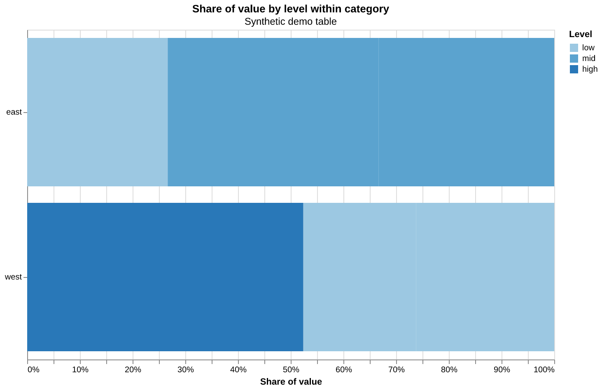
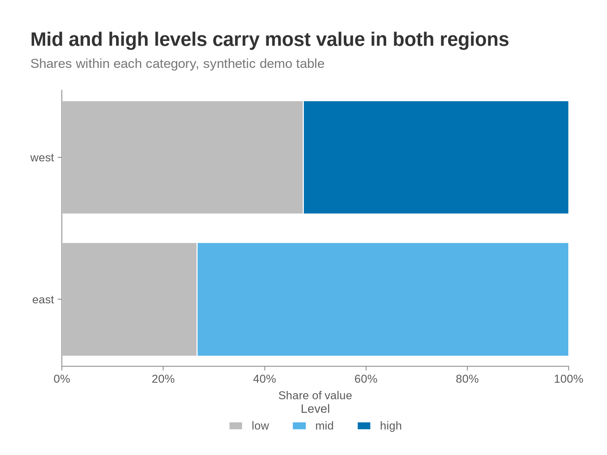
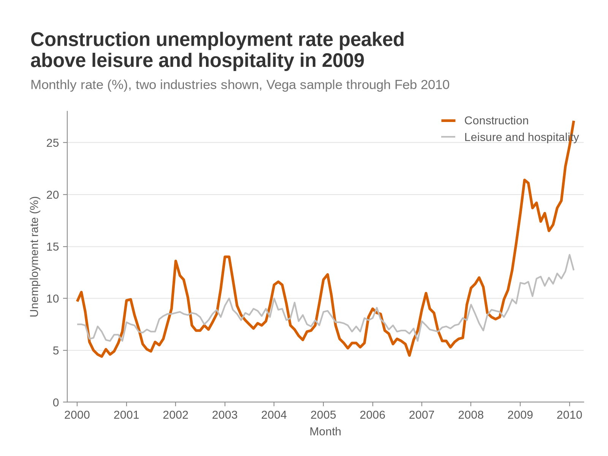

# Evaluation: build-my-chart vs evident-charts

Compute! bead `amai-lab-lnew` (Nov 2026).

**Method:** Walk-throughs written from each skill’s `SKILL.md` (and build-my-chart `best-practices.md` where relevant) against shared `scripted_answers.md` — **not live agent sessions.** Each walk-through is `evals/build-vs-evident/walkthroughs/<case>/{build-my-chart|evident-charts}/walkthrough.md` plus `final_chart.py`; PNGs are replayed by `scripts/render_charts.py`. Caught / missed below come **only** from those walk-through notes and the rendered charts.

A live head-to-head needs a real Claude or Cursor session; see README **Try it yourself**.

Data: **synthetic** `stack_synthetic.csv`; [Vega `unemployment-across-industries`](https://github.com/vega/vega-datasets) JSON.

## 1. Normalized stack (synthetic)

| | build-my-chart | evident-charts |
| --- | --- | --- |
| PNG | `evals/build-vs-evident/charts/normalized-stack-build-my-chart.png` | `evals/build-vs-evident/charts/normalized-stack-evident-charts.png` |
| Walk-through | `walkthroughs/normalized-stack/build-my-chart/` | `walkthroughs/normalized-stack/evident-charts/` |

**build-my-chart:** caught normalized stack, ordered blues for levels, scripted step-13 misread. Missed literal title, no automated checks.

**evident-charts:** caught takeaway title, percent axis, stack edges. Missed check scripts not run; matplotlib not Altair.

## 2. Many categories (14 industries, 2009)

| | build-my-chart | evident-charts |
| --- | --- | --- |
| PNG | `evals/build-vs-evident/charts/many-categories-build-my-chart.png` | `evals/build-vs-evident/charts/many-categories-evident-charts.png` |
| Walk-through | `walkthroughs/many-categories/build-my-chart/` | `walkthroughs/many-categories/evident-charts/` |

**build-my-chart:** caught zero baseline on rate, sort shows Construction first. Missed 14 hues vs best-practices **8b** (≤10 categorical hues); weak legend; generic title.

**evident-charts:** caught C3 handling (highlight + gray), legend patches match bars, Construction in title. Missed fewer grammar labels; no `check_svg` in walk-through.

## 3. Time series (Construction vs Leisure and hospitality, `rate`)

| | build-my-chart | evident-charts |
| --- | --- | --- |
| PNG | `evals/build-vs-evident/charts/time-series-build-my-chart.png` | `evals/build-vs-evident/charts/time-series-evident-charts.png` |
| Walk-through | `walkthroughs/time-series/build-my-chart/` | `walkthroughs/time-series/evident-charts/` |

**build-my-chart:** caught two series, rate axis, zero baseline. Missed equal visual weight vs communicate intent; descriptive title.

**evident-charts:** caught rate axis, two series, Construction accent, honest title/subtitle. Missed little beyond truncated sample note.

## Recommendation (walk-through scope only)

**Merge ideas:** the walk-throughs suggest keeping **build-my-chart** for an Altair grammar demo while borrowing from **evident-charts** the talk-build cadence (`talk-build.md` in the ZIP), takeaway titles, and C3-style palette discipline. This comparison does **not** prove live agent behaviour — validate that in Cursor or Claude using **Try it yourself**.