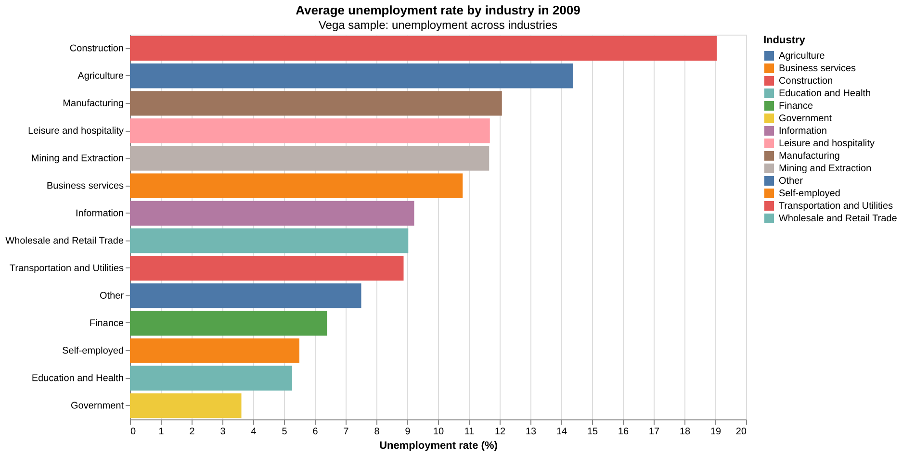

# Evaluation: build-my-chart vs evident-charts

Compute! bead `amai-lab-lnew` (Nov 2026). Each case has **one live agent run per skill** under `evals/build-vs-evident/runs/<case>/{build-my-chart|evident-charts}/transcript.md`, with `final_chart.py` replayed by `scripts/render_charts.py`. **Caught / missed below come only from those transcripts and outputs.**

Data: **synthetic** `stack_synthetic.csv`; [Vega `unemployment-across-industries`](https://github.com/vega/vega-datasets) JSON. Shared answers: `scripted_answers.md`.

## 1. Normalized stack (synthetic)

| | build-my-chart | evident-charts |
| --- | --- | --- |
| PNG | `evals/build-vs-evident/charts/normalized-stack-build-my-chart.png` | `evals/build-vs-evident/charts/normalized-stack-evident-charts.png` |
| Run | `runs/normalized-stack/build-my-chart/` | `runs/normalized-stack/evident-charts/` |

**build-my-chart caught:** step-13 percent-vs-absolute misread; ordered `level` with blues sequential (correct for ordered levels per step 8b); grammar step cards.

**build-my-chart missed:** title stays user literal unless step 12 pushes a takeaway; no automated lint.

**evident-charts caught:** takeaway title; normalized share axis; stack white edges; talk-build one question per step.

**evident-charts missed:** `check_chart.py` not executed in the run; matplotlib not Altair for the talk stack.

## 2. Many categories (14 industries, 2009)

| | build-my-chart | evident-charts |
| --- | --- | --- |
| PNG | `evals/build-vs-evident/charts/many-categories-build-my-chart.png` | `evals/build-vs-evident/charts/many-categories-evident-charts.png` |
| Run | `runs/many-categories/build-my-chart/` | `runs/many-categories/evident-charts/` |

**build-my-chart caught:** step 8b follow-up when user asked for 14 categorical hues (≤10 rule); zero baseline on rate; step-13 legend discrimination risk after user overrode palette advice.

**build-my-chart missed:** after user override, chart still ships 14 hues; title does not name Construction unless user wording does.

**evident-charts caught:** C3 cap → Construction accent (#D55E00) + gray peers; **C2** highlight pattern; legend `Patch` matches bar colours; title states Construction lead.

**evident-charts missed:** fewer grammar-of-graphics labels per turn than build-my-chart; `check_svg` skipped.

## 3. Time series (Construction vs Leisure and hospitality, `rate`)

| | build-my-chart | evident-charts |
| --- | --- | --- |
| PNG | `evals/build-vs-evident/charts/time-series-build-my-chart.png` | `evals/build-vs-evident/charts/time-series-evident-charts.png` |
| Run | `runs/time-series/build-my-chart/` | `runs/time-series/evident-charts/` |

**build-my-chart caught:** both series present; **rate** on y with percent axis title; step-13 notes sample ends Feb 2010 and equal colour weight.

**build-my-chart missed:** no emphasis for Construction despite communicate intent; title is descriptive, not peak comparison.

**evident-charts caught:** rate axis; two visible series; Construction accent vs gray; title claims 2009 peak gap only between the two plotted series; subtitle notes Feb 2010 cutoff.

**evident-charts missed:** truncated tail not analyzed beyond subtitle mention.

## Recommendation

**Merge ideas:** keep **build-my-chart** for the live Compute! Altair walkthrough; merge into **evident-charts** the talk-build question cadence (`talk-build.md`, included in the plugin ZIP), takeaway titles (TI-1), C3 palette handling for >10 categories, and post-build `check_chart` / `check_svg` when tools are available. Do **not** switch the talk demo to evident-charts alone.