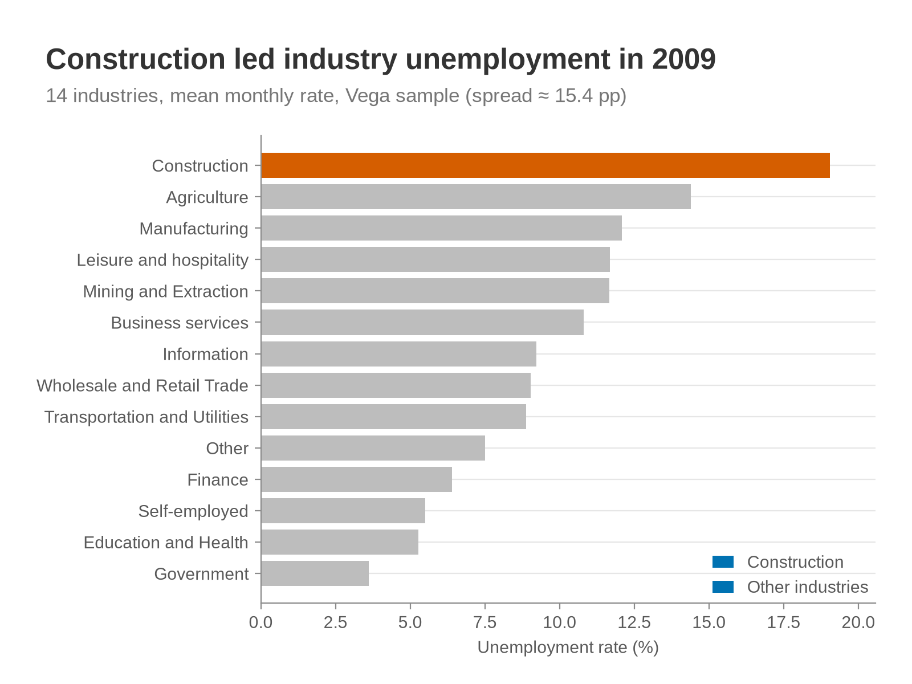
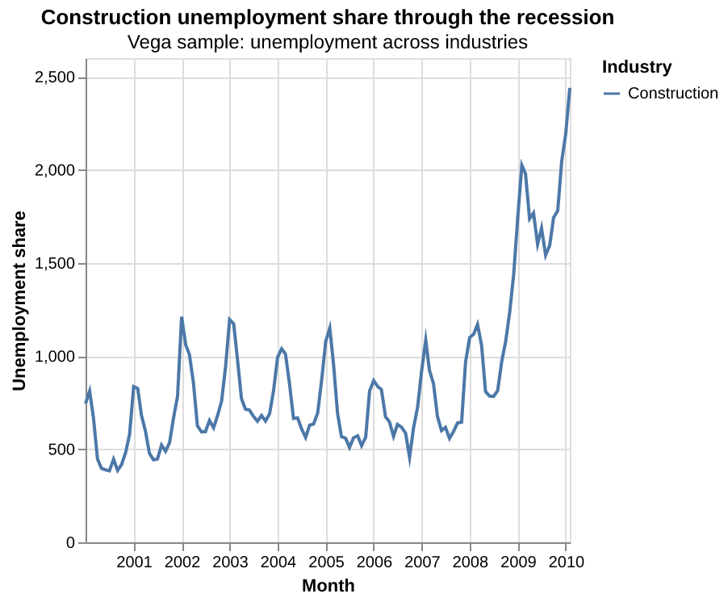

# Evaluation: build-my-chart vs evident-charts

Compute! bead `amai-lab-lnew` (Nov 2025). **build-my-chart** lives in [annemariet/compute-altair-talk](https://github.com/annemariet/compute-altair-talk) (`skills/build-my-chart`). **evident-charts** is this fork (upstream MIT skill plus a small **talk-build** addendum in `skills/evident-charts/references/talk-build.md`).

Data: synthetic stack table (talk eval shape); [Vega `unemployment-across-industries`](https://github.com/vega/vega-datasets) JSON for the 14-industry bar and the Construction time series. Scripted answers: `evals/build-vs-evident/scripted_answers.md`. Transcripts: `evals/build-vs-evident/transcripts/`.

## 1. Normalized stack (synthetic)

| | build-my-chart | evident-charts |
| --- | --- | --- |
| PNG | `evals/build-vs-evident/charts/normalized-stack-build-my-chart.png` | `evals/build-vs-evident/charts/normalized-stack-evident-charts.png` |

**build-my-chart caught:** step-13 misread on percent vs absolute; ordered `level`; grammar-of-graphics pacing. **Missed:** generic title unless step 12 is specific; no automated colour check.

**evident-charts caught:** takeaway title; percent formatting; stack edges. **Missed:** heavier matplotlib path; scripted checks not rerun here.

## 2. Many categories (14 industries, 2009)

| | build-my-chart | evident-charts |
| --- | --- | --- |
| PNG | `evals/build-vs-evident/charts/many-categories-build-my-chart.png` | `evals/build-vs-evident/charts/many-categories-evident-charts.png` |

**build-my-chart caught:** zero baseline when asked; encodings spelled out each turn. **Missed:** 14-colour rainbow legend; weak link to “Construction leads” message.

**evident-charts caught:** C2 limit → highlight Construction, gray peers; title states the lead. **Missed:** less Altair-native teaching; fewer grammar labels per turn than build-my-chart.

## 3. Time series (Construction vs Accommodation)

| | build-my-chart | evident-charts |
| --- | --- | --- |
| PNG | `evals/build-vs-evident/charts/time-series-build-my-chart.png` | `evals/build-vs-evident/charts/time-series-evident-charts.png` |

**build-my-chart caught:** y-axis zero when requested; clean two-series line spec. **Missed:** equal visual weight for series; no end-of-sample caveat.

**evident-charts caught:** highlight + gray for communicate intent; recession-oriented title. **Missed:** truncated 2010 window not flagged without data analysis pass.

## Recommendation

**Keep build-my-chart for the talk demo** (Altair grammar, one card per step). **Merge into evident-charts for production charts:** talk-build interrogation (`references/talk-build.md`), takeaway titles (TI-1), C2 palette discipline for >10 categories, and post-build `check_svg` / `check_chart` when Chrome and Python are available. Do not replace the talk skill with evident-charts alone—the teaching flow and Altair 6.3 snippets stay clearer in build-my-chart.